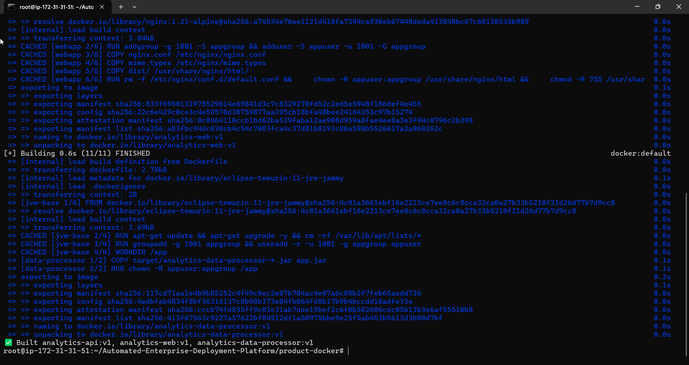
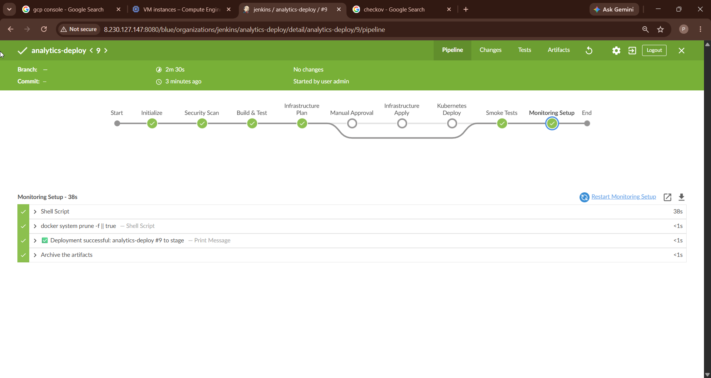
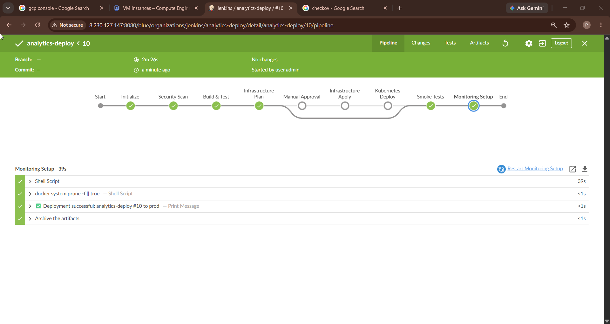
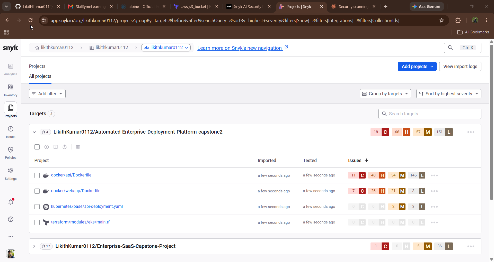
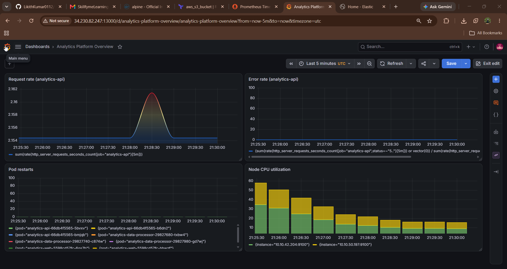
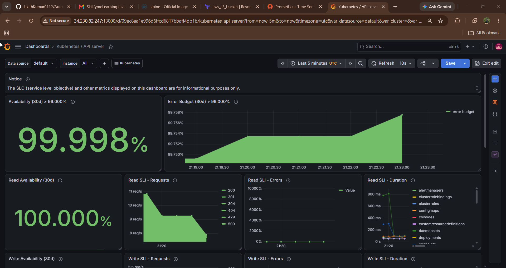
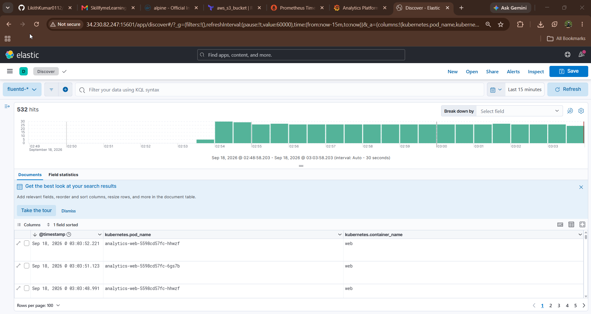
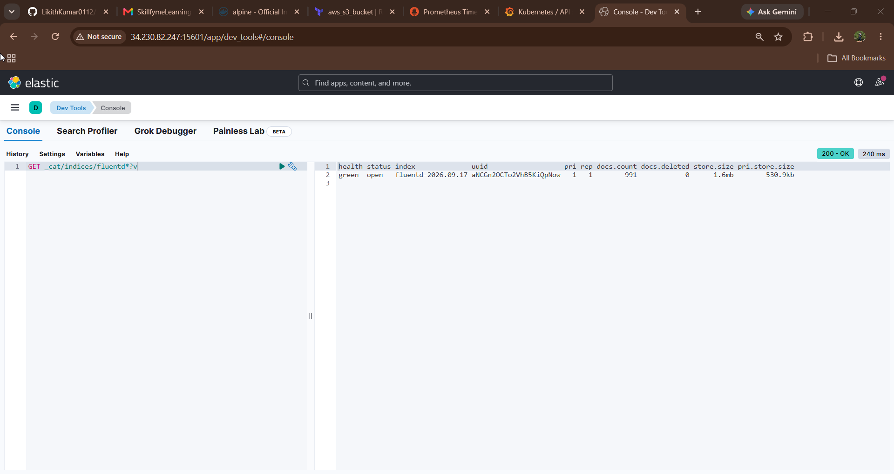
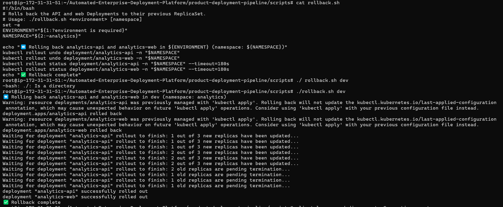

# Automated Enterprise Product Deployment Platform: Submission Evidence

**Author:** Likith Kumar  
**Repository:** <https://github.com/LikithKumar0112/Automated-Enterprise-Deployment-Platform-capstone2>  
**Prepared:** 2026-11-04

## 1. What this evidence covers

The review was based on a 20-entry ZIP, which did not contain the implementation or any execution evidence. This document presents that evidence, with its limits stated. It comes from two separate sources:

| | Source A: real AWS and Jenkins run | Source B: local verification |
|---|---|---|
| **Date** | 2026-09-17 to 2026-09-18 | 2026-11-04 |
| **Where** | AWS account in `us-east-1`, Jenkins on a GCP VM | A clean clone on a single machine, with no AWS |
| **Code tested** | The implementation before the review changes | The changed code (commits `7801b0e` and `d66c585`) |
| **Form** | Screenshots (section 3) | Command output (section 4) |

**The changed code has not been run on AWS.** AWS and Jenkins resources were not available for a re-run. Source A shows that the platform was deployed and worked on real infrastructure, but it does not show the fixes. Source B shows the fixes, but not on real infrastructure. Section 5 lists what neither source demonstrates.

Three behaviours in the Source A screenshots have since changed:

- The scanners reported findings but could not fail a build. They now block it.
- `ACTION=plan` builds still ran Smoke Tests and Monitoring Setup and printed "Deployment successful". Those stages now run for `apply` only, and a plan build reports "Plan succeeded (nothing deployed)".
- The stage names are different. "Security Scan" is now separate IaC, Dependency, and Image scan stages, plus a Push Images stage.

## 2. Review feedback coverage

| # | Review area | Now in the repository | Evidence | Still not demonstrated |
|---|---|---|---|---|
| 1 | Jenkins pipeline | Every path used by the Jenkinsfile exists | Real successful builds (Fig. 7–11); failure paths in a simulated Jenkins (4.6) | A failed build on real Jenkins |
| 2 | Terraform and EKS | Root module, modules, and tfvars for all three environments | `dev` plan and apply, active cluster (Fig. 1–4); `terraform validate` (4.1) | Stage and prod plan output; the screenshots show only the Jenkins stage view |
| 3 | Docker | Source, build scripts, and config are all included | Real build (Fig. 5–6); fresh build, startup, health, and scans (4.3, 4.4) | None for the build. `app/webapp/dist` is static, so there is no frontend build stage |
| 4 | Kubernetes | Deployments, Services, Ingress, ConfigMap for API, web, and CronJob | Live EKS (Fig. 12–14); schema validation (4.7); manual rollback (Fig. 24) | One manifest set with no overlays; a rolling update to a new version on EKS |
| 5 | Security | Blocking Checkov, Snyk, and Trivy gates; AWS Secrets Manager only; Vault claims removed | Trivy and Checkov blocking (4.2, 4.4); old Snyk findings (Fig. 16) | Real Snyk blocking a build; the Jenkins host still holds static AWS credentials |
| 6 | Monitoring and logging | Prometheus, Grafana, Alertmanager, and EFK manifests and values | Live dashboards, targets, and logs (Fig. 18–23); Alertmanager config check (4.7) | An alert firing and reaching Slack; rules tested against real metrics |
| 7 | Rollback and failure handling | Smoke tests fail after the last retry; automatic rollback in the pipeline | Failing smoke test (4.5); simulated rollback (4.6); manual rollback (Fig. 24) | A failed deployment on EKS; Terraform state recovery; RTO and RPO measurements |
| 8 | Completeness and docs | Docs now describe what is implemented; false claims removed | Clean-clone build and validation (section 4) | A clean-clone deployment to AWS |

## 3. Source A: real run, September 2026

All of these predate the review changes. The figure captions note where a screenshot has a limitation.

### 3.1 Infrastructure


*Figure 1. `terraform plan` for `dev`, first run: 40 resources to add.*


*Figure 2. A later `terraform apply`: 2 added, 16 changed, with output values.*


*Figure 3. Cluster `analytics-dev` active on Kubernetes 1.35. The console session was signed in as the root user, which should not be repeated; `docs/evidence-checklist.md` requires an IAM user.*


*Figure 4. Node group ready, on `v1.35.7-eks-cb19647`.*

### 3.2 Application build



*Figure 5. Multi-target Docker build of all three images.*


*Figure 6. `docker images` and the build scripts.*

### 3.3 Jenkins pipeline


*Figure 7. `dev` with `ACTION=plan`, build #6. Approval, Apply, and Deploy were skipped.*


*Figure 8. `dev` with `ACTION=apply`, build #8: full deployment in 2m 41s.*


*Figure 9. Smoke Tests stage with curl output from inside the pipeline.*



*Figure 10. `stage` with `ACTION=plan`, build #9. Nothing was deployed. This shows the pipeline view, not the Terraform plan output.*



*Figure 11. `prod` with `ACTION=plan`, build #10. Nothing was deployed and the approval step was not reached, so this does not demonstrate the approval gate.*

Stage and prod were not deployed: the account's 8 vCPU On-Demand quota was half used by `dev`. `EXECUTION.md` section 5 records the mentor-approved scope.

### 3.4 Kubernetes and Ingress


*Figure 12. `kubectl get all -n analytics`: pods, Deployments, ReplicaSets, and the CronJob.*


*Figure 13. curl against the live ALB over HTTP, returning `{"status":"UP",...}`. One `data-processor` pod is shown Pending for 82 minutes.*


*Figure 14. Application health endpoints through a port-forward.*

### 3.5 Security scanning

These show that the scanners ran and found issues, and also that they did not stop the build. Section 4 shows the blocking behaviour.


*Figure 15. Checkov: 78 passed, 18 failed. The build was not blocked.*


*Figure 16. `snyk test` in Jenkins, build #13: Critical findings in `app/api` through Spring Boot 2.7.18. The build was not blocked.*



*Figure 17. Snyk web report. It scanned old sample files on `main`, **not** the deployed code, so it is not evidence about this implementation.*

### 3.6 Monitoring and logging



*Figure 18. Grafana, Analytics Platform Overview with live data.*



*Figure 19. Grafana, Kubernetes API Server dashboard.*


*Figure 20. Prometheus targets: `analytics-api` ServiceMonitor, 3/3 up.*



*Figure 21. Kibana Discover: ingested logs, 532 hits.*


*Figure 22. Elasticsearch cluster health: green, 3 nodes.*



*Figure 23. Fluentd index document count at one point in time, so it does not show growth.*

These dashboards were reached on a public IP over HTTP, with Elasticsearch security off and Grafana on its default password. Section 5 lists this as an open gap.

### 3.7 Rollback



*Figure 24. `rollback.sh` run by hand against a healthy `dev` deployment: `kubectl rollout undo` and rollout status. No deployment had failed, and image versions are not shown, so this demonstrates the rollback command but not recovery from a failure.*

## 4. Source B: local verification, 4 November 2026

These checks ran on clean clones, without AWS, using the tools and scripts in the repository. Commit `7801b0e` is the changed code on Spring Boot 2.7.18, and `d66c585` adds the upgrade to Spring Boot 4.1.2 and Java 17, which changes only the API dependency versions and base image. Sections 4.3 and 4.4 ran on both, 4.6 ran on the final Jenkinsfile, and the others ran on `7801b0e`. These commit IDs and the ones in the logs were updated after a later edit to commit messages; the code at each commit is unchanged. The output below is trimmed; full output is in [`docs/evidence/local-2026-11-04/`](evidence/local-2026-11-04/).

### 4.1 Terraform validates

```text
Terraform v1.17.1
Success! The configuration is valid.
validate exit=0
fmt -check exit=0
```

This is `terraform init -backend=false`, so it checks configuration only. It is not a plan.

### 4.2 Checkov blocks a new finding

The 22 existing findings are recorded in `product-infrastructure/.checkov.baseline` and listed in `docs/security.md`. They are accepted debt, not fixed.

The current code passes (`exit=0`). With a security group that opens SSH to `0.0.0.0/0` added to a temporary copy:

```text
Passed checks: 0, Failed checks: 3, Skipped checks: 0
Check: CKV_AWS_23: "Ensure every security group and rule has a description"
Check: CKV_AWS_24: "Ensure no security groups allow ingress from 0.0.0.0:0 to port 22"
Check: CKV2_AWS_5: "Ensure that Security Groups are attached to another resource"
exit=1
```

### 4.3 Images build and run as non-root

All three images built from the clean clone at `d66c585`. The API and web containers started and passed `scripts/health-check.sh`. The Prometheus metric used by the Grafana dashboard is still present after the upgrade:

```text
$ docker exec ev-api id
uid=1001(appuser) gid=1001(appgroup) groups=1001(appgroup)
$ docker exec ev-web id
uid=1001(appuser) gid=1001(appgroup) groups=1001(appgroup)
$ health-check.sh http://127.0.0.1:18080 /actuator/health 30 3
Attempt 1/30 failed, retrying in 3s...
Attempt 2/30 failed, retrying in 3s...
Healthy after 3 attempt(s)
exit=0
$ curl -s http://127.0.0.1:18080/actuator/health
{"groups":["liveness","readiness"],"status":"UP"}
liveness: 200, readiness: 200
$ curl -s .../actuator/prometheus | grep -m1 http_server_requests_seconds_count
http_server_requests_seconds_count{error="none",exception="none",method="GET",outcome="SUCCESS",status="200",...
$ health-check.sh http://127.0.0.1:18081 /health 10 2
Healthy after 1 attempt(s)
exit=0
```

### 4.4 Trivy blocks HIGH and CRITICAL vulnerabilities

`scripts/scan-image.sh` is the same script the pipeline's Image Scan stage uses. It ignores vulnerabilities with no available fix.

| Image | Result | Exit code |
|---|---|---|
| `analytics-api` on Spring Boot 2.7.18 (`7801b0e`) | 49 findings: 40 HIGH, 9 CRITICAL | **1 (blocked)** |
| `analytics-api` on Spring Boot 4.1.2 and Java 17 (`d66c585`) | 0 | 0 |
| `analytics-web` (`d66c585`) | 0 | 0 |
| `analytics-data-processor` (`d66c585`) | 0 | 0 |

The first row shows the gate stopping the vulnerable version, and the second shows the fix passing. The upgrade is a major version jump. The API starts and responds as shown in 4.3, but it has not run on EKS, and `app/` has no automated tests.

### 4.5 Smoke tests fail after the last retry

```text
$ health-check.sh http://127.0.0.1:18099 /health 3 1   # nothing is listening
Attempt 1/3 failed, retrying in 1s...
Attempt 2/3 failed, retrying in 1s...
Attempt 3/3 failed, retrying in 1s...
http://127.0.0.1:18099/health not healthy after 3 attempts
exit=1

$ health-check.sh http:// /health   # Ingress has no address
No endpoint to check (URL is empty - has the Ingress got an address?)
exit=1
```

### 4.6 Pipeline failure paths, simulated

The actual Jenkinsfile ran on a throwaway Jenkins with the sandbox on and the declarative linter passing. **AWS, Docker, Terraform, kubectl, Helm, Maven, and Snyk were stand-in scripts that returned chosen results.** This tests the pipeline's control flow, not the tools. The results are in `12-jenkins-scenarios.txt`.

| Scenario | Result |
|---|---|
| `dev` plan | Success; no image push, no Terraform apply, no Kubernetes or Helm changes |
| `dev` apply | Success |
| Checkov, Snyk, or Trivy fails (3 scenarios) | Build fails; no push, no rollback |
| Terraform fails | Build fails; no rollback |
| A secret is missing from Secrets Manager | Build fails before the manifests are applied; no rollback |
| Rollout fails, smoke test fails, or Ingress has no address (3 scenarios) | Build fails; rollback runs |
| Monitoring Setup fails | Build fails; no rollback, because the application had already passed its smoke test |
| Rollback itself fails | Build reports "ROLLBACK FAILED" |
| `prod` with scans turned off | Refused at Initialize |
| `prod` apply | Pauses at Manual Approval |

### 4.7 Kubernetes and monitoring configuration

```text
kubeconform: 10 resources found in 5 files - Valid: 10, Invalid: 0, Errors: 0, Skipped: 0

helm template exit=0  (kube-prometheus-stack with this project's values)
amtool check-config: SUCCESS
  global config, route, 4 inhibit rules, 4 receivers, 1 templates

Project alert rules in the rendered chart:
  HighErrorRate, PodCrashLooping, DeploymentStuck
```

This shows that the configuration is valid. It does not show an alert firing.

## 5. Not demonstrated

**Requested by the review, and not shown by either source:**

- The changed pipeline running on real Jenkins and AWS, including a failed build.
- Terraform plan output for stage and prod.
- The production approval gate being reached. Figure 11 stops before it.
- Snyk blocking a build. Its gate has run only with a stand-in, and real Snyk could report findings that Trivy does not.
- A failed deployment on EKS rolling back automatically, with the previous version confirmed restored.
- An alert firing and reaching Slack, and alert rules tested against real metrics.
- Terraform state recovery.
- Measured RTO and RPO. The documented 4-hour and 24-hour figures are objectives, not measurements. The project has no database, so RPO applies only to Terraform state.
- A clean-clone deployment to AWS.

[`docs/evidence-checklist.md`](evidence-checklist.md) has the exact steps to capture each of these when AWS resources are available.

**Known gaps in the implementation:**

- HTTP only, with no TLS certificate. The WAF is provisioned but not attached.
- The Jenkins host holds AWS credentials because the pipeline does not assume the `ci_deploy` role.
- Elasticsearch security is off and Grafana uses its default password.
- `app/` has no automated tests, so the pipeline's test step verifies compilation only.
- The Checkov baseline holds 22 accepted findings.
- Kubernetes manifests have no per-environment overlays.

## 6. Reproducing section 4

From a fresh clone, with Docker installed:

```bash
# Terraform
docker run --rm -v "$PWD/product-infrastructure:/iac" -w /iac hashicorp/terraform:latest init -backend=false
docker run --rm -v "$PWD/product-infrastructure:/iac" -w /iac hashicorp/terraform:latest validate

# Checkov
docker run --rm -v "$PWD/product-infrastructure:/iac" bridgecrew/checkov:3.3.19 \
  -d /iac --framework terraform --compact --quiet --baseline /iac/.checkov.baseline

# Build (use maven:3.9-eclipse-temurin-11 at 7801b0e)
docker run --rm -v "$PWD:/w" -w /w/product-docker maven:3.9-eclipse-temurin-17 ./build-scripts/stage-local-app.sh
(cd product-docker && docker build --target api -t analytics-api:evidence .)

# Trivy: expect exit 0 at d66c585, exit 1 at 7801b0e
product-deployment-pipeline/scripts/scan-image.sh analytics-api:evidence; echo "exit=$?"
```
